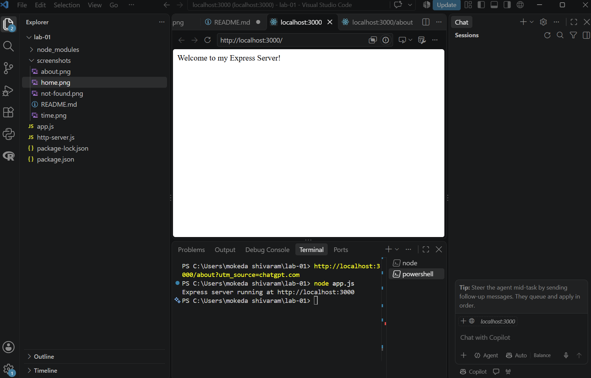
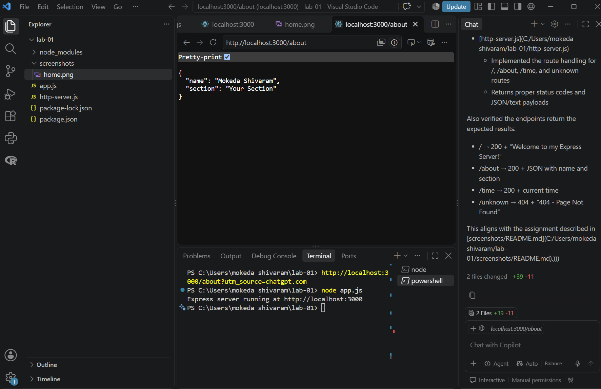
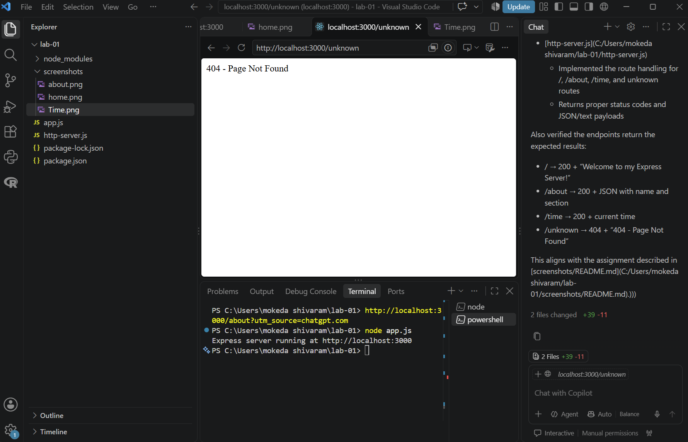

# Lab 1: Node.js and Express Server

**Name:** MOKEDA SHIVARAM  
**Registration Number:** 252U1R5104  
**Section:** AIDE 313  
**Course:** Backend Development Fundamentals

## 1. Objective

To create a web server using the Node.js HTTP module and Express.js, implement different GET routes, and handle unknown routes using HTTP 404 status codes.

## 2. Installation

Install the required dependencies:

```bash
npm install
```

## 3. How to Run

**Node.js HTTP Server**

```bash
node http-server.js
```

**Express Server**

```bash
node app.js
```

Server runs at: `http://localhost:3000`

## 4. Endpoints

| Method | Path | Description | Status |
|---|---|---|---|
| GET | / | Displays welcome message | 200 |
| GET | /about | Returns name and section in JSON | 200 |
| GET | /time | Displays current date and time | 200 |
| GET | /unknown | Displays page not found message | 404 |

## 5. Screenshots

### Home Route


### About Route


### Time Route


### 404 Route


## 6. Live Link

Not deployed yet. The application is currently running locally.

## 7. Problems Faced

Initially, npm was not recognized in the MSYS2 terminal. This problem was solved by configuring Node.js and npm and switching to PowerShell in VS Code.

## 8. Conclusion

Successfully created a basic HTTP server using Node.js and an Express server with multiple GET routes. Tested all endpoints and verified the appropriate HTTP status codes, including 200 OK and 404 Not Found.